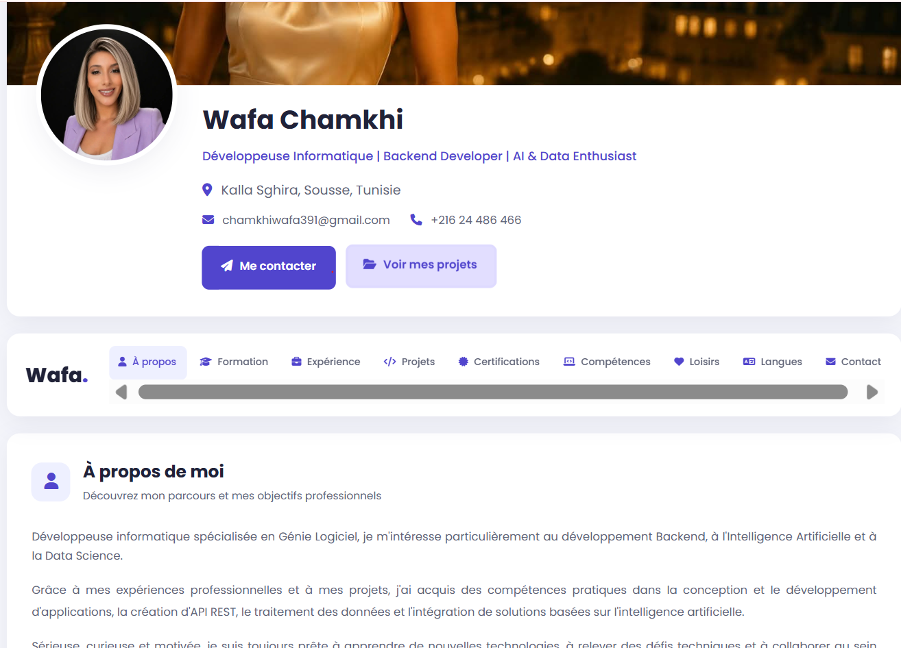

## Portfolio Preview




# Wafa Chamkhi | Personal Portfolio

Welcome to my personal portfolio! This project showcases my professional profile, technical skills, educational background, experience, certifications, and development projects.

## About Me

I am Wafa Chamkhi, a software development enthusiast passionate about web development, programming, and modern technologies.

I enjoy building practical applications, solving technical problems, and continuously improving my skills through learning and hands-on projects.

This portfolio represents my professional journey, technical abilities, and projects.

## Project Overview

The Personal Portfolio is a web application developed to present my professional profile in a clear, organized, and interactive way.

It allows visitors to discover my background, explore my projects, review my skills, and contact me.

## Technologies Used

The project was developed using the following technologies:

- **PHP** – Backend development and server-side logic.
- **MySQL** – Database management and data storage.
- **HTML5** – Web page structure.
- **CSS3** – Styling and responsive interface.
- **JavaScript** – Interactive functionality.
- **XAMPP** – Local development environment.
- **Git & GitHub** – Version control and source code management.

## Main Features

- **Home Page:** Introduction and personal presentation.
- **About Me:** Personal and professional information.
- **Education:** Academic background.
- **Experience:** Professional experience.
- **Technical Skills:** Programming languages and technologies.
- **Certifications:** Professional certifications and achievements.
- **Projects Portfolio:** Presentation of completed projects.
- **Project Management:** Add, edit, and delete projects.
- **Contact Form:** Allows visitors to send messages.
- **Database Integration:** Stores and manages application data.

## Project Structure

```text
Portfolio/
│
├── backend/
│   ├── add_project.php
│   ├── edit_project.php
│   ├── delete_project.php
│   └── send_message.php
│
├── config/
│   └── database.php
│
├── css/
│   └── style.css
│
├── database/
│   └── portfolio.sql
│
├── images/
│   └── projects/
│
├── includes/
│   ├── About.php
│   ├── Education.php
│   ├── Experience.php
│   ├── Skills.php
│   ├── Certifications.php
│   ├── Projects.php
│   └── ...
│
├── js/
│   └── script.js
│
├── index.php
└── README.md
```

## Installation and Setup

To run this project locally, follow these steps:

### 1. Clone the Repository

```bash
git clone https://github.com/wafa797/portfoliophpwafa.git
```

### 2. Move the Project

Move the project folder into the XAMPP `htdocs` directory.

### 3. Start XAMPP

Start the following services:

- Apache
- MySQL

### 4. Configure the Database

- Open phpMyAdmin.
- Create a MySQL database.
- Import the SQL file located in `database/portfolio.sql`.
- Configure the database connection in `config/database.php`.

### 5. Run the Project

Open your browser and visit:

```text
http://localhost/Portfolio/
```

## Database

The application uses MySQL to store and manage portfolio-related information.

The database structure is provided in:

```text
database/portfolio.sql
```

## Author

**Wafa Chamkhi**

Software Development | Web Development

GitHub: [@wafa797](https://github.com/wafa797)

Portfolio Repository: [portfoliophpwafa](https://github.com/wafa797/portfoliophpwafa)

---

Thank you for visiting my repository!

Feel free to explore my work and projects.
